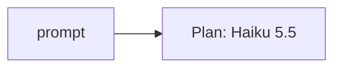
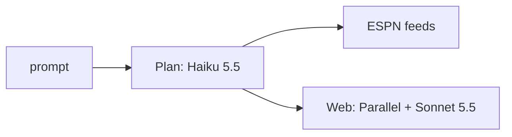
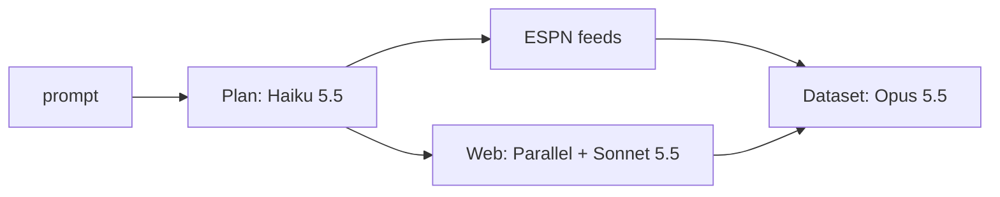
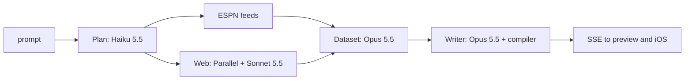

# Session handoff, 25 and 26 October 2026

openui-gen now generates football screens. You type a request such as "Chelsea vs Man City, last meeting stats". The server answers it from ESPN and cited web search, then streams an OpenUI Lang program that the web preview and the iOS app both render with your Sports components in club colours. Stocks, Massive and FMP are gone. Nothing from this session is committed yet.

This file covers how the pipeline works, what changed in each project, and what is left.

## How a request becomes a screen

The server runs four stages, each on its own Claude model. The first one turns the request into questions.



Haiku reads the request once and returns 1 to 5 questions, one per part of the screen. It also resolves club names. The planner loads ESPN's club list for the Premier League, LaLiga, Bundesliga and Serie A, and Haiku must answer with an exact name from it. "Barça" comes back as Barcelona and "Man City" as Manchester City. Each question then reads its club's league, so a Barcelona question in a Premier League conversation goes to LaLiga.



Every question runs at the same time. A question goes to ESPN when one of its feeds has the data. ESPN covers the league table, a day's scoreboard, a team's schedule, one match between two clubs (shots, possession, goals with scorer and assist, player stats), the season's scoring and assist leaders, and the team list. Everything else is a web search. Parallel finds and reads the pages, then Sonnet 5.5 extracts one record with citations. A web answer that cites no page it read comes back "unavailable" with a note, so the screen never shows invented figures.



Opus 5.5 designs the dataset. It reshapes each answer into the fields a screen needs, and when an answer suits a Sports component it shapes it to that component's contract. The server validates every field and value. A design that fails validation is dropped and the raw answer is kept instead. The dataset also carries `d.clubs`: every club the request names, fetched from ESPN by id with its colour, logo and short name.



Opus 5.5 then writes the screen in OpenUI Lang. The compiler admits each statement as it streams and rejects anything that reads a missing path or breaks a primitive's types. Any question still not shown gets a default part, which is a Sports component when the answer fits one. The client receives `activity`, `data`, `skeleton`, `openui`, `issue`, then `done`.

A live run takes 80 to 130 seconds. Planning takes about 6 seconds, the parallel research 12 to 18, the dataset design about 50 and the writer about 65.

## How the Sports components reach the screen

The components live in `src/sports/components.ts`. Each entry has a name, what it is for, when to use it, and a data contract that lists every field it reads. MatchCard, TeamDetail, StatBar, Leaderboard, FixturesHeatmap and StatsCard are all there. `npm run openui:export` writes the same index to `catalog/openui/sports-components.json`.

They are server templates. A call such as `MatchCard(d.answers.q1.match)` expands to the 42 OpenUI primitives before the client sees it. So the web preview and iOS render them without knowing they exist. Club colours work through two primitive changes. Avatar has a new `color` prop that takes a `#rrggbb` from the data, and SplitBar sides take an optional `color`. Both renderers draw them.

## Done in openui-gen

The server:

- Added the sports pipeline in `src/sports/` (plan, ESPN client, research, dataset, screen pack, components, orchestrator) and the route in `src/routes/sports.ts`. It serves `POST /lang/sports/stream` and `POST /tools/sports_dataset`.
- Gave the Anthropic adapter per-call `effort` and the API's server-side refusal fallback. Opus and Sonnet calls use it. Haiku has none.
- Made the compiler take its dataset tool from the screen pack, and made snapshots accept `sports_dataset` from `web`, `espn` or `mixed` sources.
- Retired stocks completely. That removed `src/stocks/`, the stocks and logo routes, the Massive and FMP config, four check scripts, the recorded fixtures, `catalog/openui/fixtures.json` and `OPENUI-FOLLOWUPS.md`. `check-lang` was rewritten around a sports dataset.
- Made the boot check require `ANTHROPIC_API_KEY` and `PARALLEL_API_KEY`.
- Added `scripts/check-sports.ts`. It covers pipeline wiring, uncited answers, rejected designs, plan routing, club resolution, schedule results, the match feed's fallback to last season, and the components with their colours. Mutants confirmed the main checks fail when their rule breaks.

The iOS app in `ios/`:

- It is an XcodeGen project with a root `Makefile` that replaces the old `ios-gin` commands. `make backend` starts the server and `make help` lists the rest.
- The OpenUI engine was ported from FitnessGin into `ios/OpenUIGen/GenUI/`. That covers the parser and compiler, the session, the SSE client and the 42 Kino primitives. Kino tokens load from `design/` in this repo.
- The ask screen streams from `/lang/sports/stream`. 29 tests pass, and lint and format are clean.

The web preview now calls `/lang/sports/stream` and draws the new Avatar and SplitBar colours.

## Done in ui-canvas

- Kino is enforced for every new exploration. `design/rules.json` defines it, and `rules:sync` generates `web/app/kino.css` and the token sheet `prompts/kino.md`. A pre-write hook in `.claude/settings.json` rejects a component write that breaks the rules, and `canvas register`, `check` and `audit` refuse such components too.
- `npm run canvas -- delete <id>` lists everything that belongs to an exploration. With `--yes` it moves the files to the Trash and removes the registry lines and index rows.
- Built the Sports Components canvas (TeamDetail, MatchCard, Match result, StatBar, Leaderboard, FixturesHeatmap, StatsCard), the completed `stats-grid` exploration (3 batches of 5) and the `match-card` exploration.

The pragmatic-testing skill is installed in `~/.claude/skills/` and in this repo's `.claude/skills/`.

## Left to do

1. Commit. openui-gen has every change unstaged. ui-canvas is not a git repository, and backups of the files edited there are in this session's scratchpad.
2. Build sports follow-ups. The document store and the iOS session's staged follow-up already exist. The server needs `/lang/sports/:documentId/follow-up`, and `done` needs to return the document again.
3. Write sports fixtures for the compiler parity test. `fixtures.json` and the iOS `OpenUIFixtureTests` were deleted with stocks, so nothing compares the Swift compiler with the server's output right now.
4. Bring latency down. The dataset and writer stages take about two minutes together. Test Opus at medium effort, or Sonnet 5.5 for the dataset stage.
5. Check whether the writer calls components by name or copies their structure. The live run admitted every statement either way, but calls are shorter to stream.
6. Decide which components to make native. FixturesHeatmap uses Badges for its squares, and Kino has no true red for the low rating bracket.
7. Add more ESPN competitions. The FA Cup and Champions League have their own league codes and still go to web search.
8. Remove the unused OpenRouter code and the old Massive and FMP keys from `.env`.
9. In ui-canvas, rerun the `voice-memo-cards` browser review. Its staleness check fails because `design/rules.json` changed. Also open `/hooks` once in a ui-canvas session so the Kino pre-write hook loads.

## Running and checking

```sh
make backend                                  # server on :8080
npm --prefix preview run dev -- --port 3001   # preview (port 3000 is taken by FitnessGin_BE)
npm run check:all                             # every server check, no network
make test                                     # iOS tests
```

The iPhone 17 Pro simulator got stuck shutting down during this session, so the iOS tests ran on iPhone Air. Screenshots from the live runs are in `~/Desktop/openui-gen-screenshots/`.
